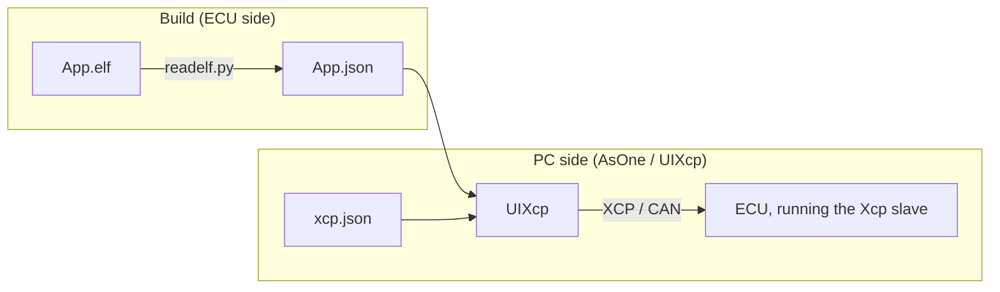
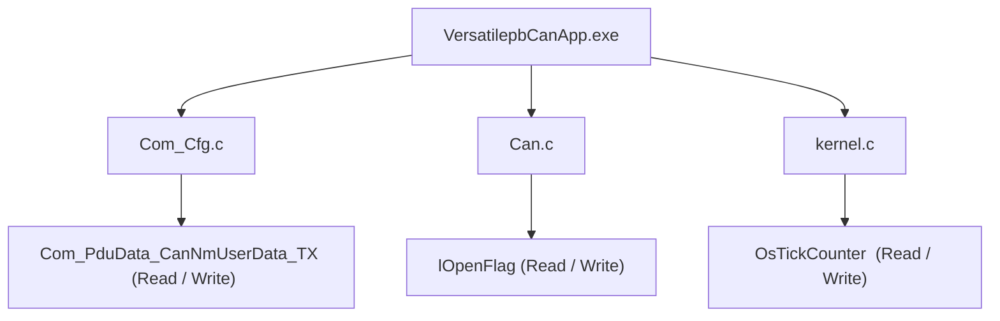
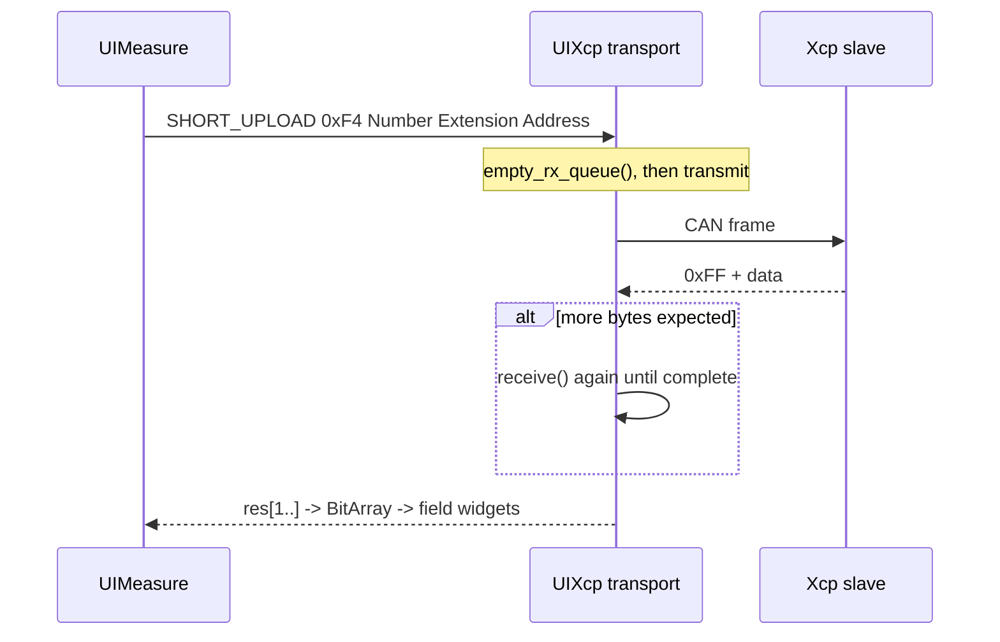
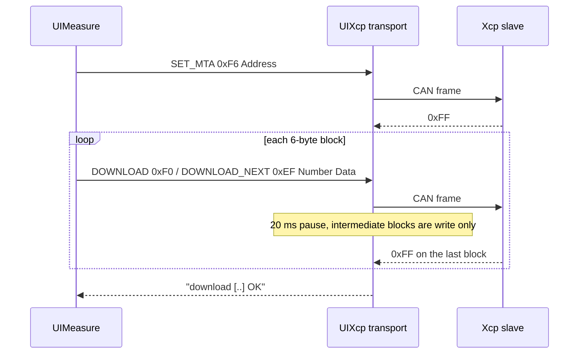

\---  
layout: post  
title: UIXcp Measurement and Calibration  
category: Tools  
comments: true  
\---

# UIXcp Measurement and Calibration

UIXcp is the [XCP](https://www.asam.net/standards/detail/xcp/) panel of the [AsOne](../../tools/asone) PC tool. It puts the two most common XCP jobs in one window:

- **driving services** — the service definitions live in [tools/asone/examples/xcp.json](../../tools/asone/examples/xcp.json): which bus and which two CAN IDs to use, and which XCP services the panel offers (`Connect`, `GetStatus`, `GetSeed`/`Unlock`, `SetMTA`, `Upload`, `ShortUpload`, `Download`, `Program*`, `DAQ*`, ...);
- **reading and writing variables by address** — the variable list does not have to be typed in by hand. The linker already knows every global variable and its address, and keeps it in the ELF's DWARF debug information. [tools/utils/readelf.py](../../tools/utils/readelf.py) turns that into a JSON file (UIXcp loads it as `XcpEcu.Json` by default), and the panel turns every variable into a small widget with `Read` and `Write` buttons.

Both uses share the same transport and the same framing and parsing code, so this page covers both: section 2 is the XCP json, sections 3 to 6 are the variable JSON and how it is read and written, and section 7 is the full walkthrough on a QEMU target.

## 1. Overview

Three inputs come together in the XCP panel:

| Input      | Default                                                              | Role                                                      |
| ---------- | -------------------------------------------------------------------- | --------------------------------------------------------- |
| XCP json   | [tools/asone/examples/xcp.json](../../tools/asone/examples/xcp.json) | `target` transport, `groups` service list, `lua` script   |
| Ecu json   | `XcpEcu.Json`                                                        | The variable list — addresses, types and field layout     |
| Lua script | named by the `lua` key of the XCP json                               | Seed & key, upload/download field encode and decode hooks |

The XCP json decides **which XCP services the panel has**: every entry under `groups[].Services[]` becomes one command form (see 2.3). Reading and writing variables is only **one** of the panel's uses — underneath it is `ShortUpload`, and `SetMTA` plus `Download`, with the address filled in for you from the variable JSON; the other use is driving those named services by hand.



## 2. The XCP JSON: Transport and Services

### 2.1 The three top-level keys

| Key      | Content                                                             |
| -------- | ------------------------------------------------------------------- |
| `target` | Transport: protocol, device, channel, baudrate, txid/rxid           |
| `groups` | The services the panel offers, split into groups, one tab per group |
| `lua`    | Lua script file name, resolved relative to this JSON                |

An excerpt of the real file (`groups` keeps only one service of the `General` group):

```json
{
    "target": {
      "protocol": "CAN",
      "LL_DL": 8,
      "device": "simulator_v2",
      "port": 0,
      "txid": "0x7A0",
      "rxid": "0x7B0",
      "baudrate": 500000
    },
    "lua": "xcp.lua",
    "groups": {
      "General": {
        "Services": [
          {
            "name": "Connect",
            "SID": "0xFF",
            "transmit": [
                { "name": "Mode", "type": "U8Select", "Select": [{ "name": "Normal", "value": "0x00" }, { "name": "User Defined", "value": "0x01" }] }
            ],
            "receive": [
              { "name": "RESOURCE", "type": "U8", "display": "hex", "default": 0, "lua": "decode_xcp_res" },
              { "name": "COMM_MODE_BASIC", "type": "U8", "display": "hex", "default": 0, "newline": true },
              { "name": "MAX_CTO", "type": "U8", "display": "hex", "default": 0 },
              { "name": "MAX_DTO", "type": "U16", "display": "hex", "default": 0, "newline": true },
              { "name": "XCP Protocol Layer Version Number", "type": "U16", "display": "hex", "default": 0 }
            ]
          }
        ]
      }
    }
}
```

### 2.2 `target`: the transport

| Field      | Default        | Meaning                                                                                                                                            |
| ---------- | -------------- | -------------------------------------------------------------------------------------------------------------------------------------------------- |
| `protocol` | `CAN`          | Only `CAN` is supported, any other value fails `start` with invalid protocol                                                                       |
| `device`   | `simulator_v2` | CanLib device name, see [virtual CAN environment](./virtual-can-env.md)                                                                            |
| `port`     | `0`            | Channel number                                                                                                                                     |
| `baudrate` | `500000`       | Baudrate, ignored by virtual devices                                                                                                               |
| `LL_DL`    | `8`            | Data length of one transport frame (a response frame is also this long, so one Short Upload carries at most `LL_DL - 1` data bytes, see section 5) |
| `txid`     | `0xFA0`        | CAN ID panel to slave                                                                                                                              |
| `rxid`     | `0xFB0`        | CAN ID slave to panel                                                                                                                              |

`txid` and `rxid` may be written as numbers or as strings such as `"0x7A0"`. On `start` the panel opens the bus with `protocol` / `device` / `port` / `baudrate`, and shows the whole `target` object as one entry of the `target:` combo box — the box is editable, so a `target` text can simply be pasted in and the link can be changed without touching the file.

### 2.3 `groups` and `Services`: the service forms

Each key of `groups` is one group: it becomes a top-level node in the left tree and adds a tab with the same name. Under a group only the `Services` array matters, and every entry of it becomes one form:

- `name` — the form title, and the name of the child node in the tree;
- `SID` — the command code, put first in the request when `Enter` is pressed;
- `transmit` — the fields after `SID` in the request, encoded in order;
- `receive` — the fields of the response, parsed starting at the first response byte (byte 0 is the `0xFF` positive response code and is skipped).

The shipped xcp.json offers four groups:

| Group     | Services (SID)                                                                                                                                                                                                |
| --------- | ------------------------------------------------------------------------------------------------------------------------------------------------------------------------------------------------------------- |
| `General` | `Connect`(FF), `GetStatus`(FD), `GetSeed`(F8), `Unlock`(F7), `Disconnect`(FE)                                                                                                                                 |
| `MTA`     | `SetMTA`(F6), `Download`(F0), `Upload`(F5), `ShortUpload`(F4)                                                                                                                                                 |
| `PGM`     | `ProgramStart`(D2), `ProgramClear`(D1), `Program`(D0), `ProgramReset`(CF)                                                                                                                                     |
| `DAQ`     | `FreeDAQ`(D6), `AllocDAQ`(D5), `AllocODT`(D4), `AllocODTEntry`(D3), `ClearDAQList`(E3), `SetDAQPtr`(E2), `WriteDAQ`(E1), `ReadDAQ`(DB), `SetDAQListMode`(E0), `StartStopDAQList`(DE), `DAQStartStopSynch`(DD) |

Services without parameters, such as `Disconnect`, `FreeDAQ` and `ProgramReset`, have empty `transmit` / `receive` arrays, so their form is just the SID byte.

The field type comes from `type`, written as `U<bit width>` plus an optional suffix:

| `type`                     | Widget                   | Encoded width                                       |
| -------------------------- | ------------------------ | --------------------------------------------------- |
| `U8` / `U16` / `U32`       | edit box                 | the bit width is the field width                    |
| `U8Array` + `size`         | edit box (array literal) | `size` bytes                                        |
| `U8Select` + `Select`      | combo box                | the `value` of the selected entry                   |
| `U8MultiSelect` + `Select` | multi selection          | the `value`s of the selected entries OR-ed together |
| `Table`                    | table filled in by Lua   | length decided by Lua, see 2.4                      |

A field may also carry these keys:

| Key        | Meaning                                                                           |
| ---------- | --------------------------------------------------------------------------------- |
| `display`  | `dec` (default) / `hex` / `asc`                                                   |
| `default`  | initial value, a number or a string such as `"0x00"`                              |
| `newline`  | start a new row after this field                                                  |
| `optional` | the field may be missing in the response (e.g. `First PID` of `StartStopDAQList`) |
| `readonly` | read only in the UI, the value is computed by Lua (e.g. `keys` of `Unlock`)       |
| `visible`  | `false` hides the field, it still takes part in encode and decode                 |
| `lua`      | the Lua hook of this field, see 2.4                                               |

`Enter` builds and sends the frame; the response is then parsed back into the fields and shown as `XXX OK with response [...]`. If the first response byte is not `0xFF`, the formatting helper appends `nrc = ...` text to the hex dump (`0x23` memory write protected, `0x24` memory not accessible, `0x25` seed & key required, ...).

`Download`(F0) and `Program`(D0) are handled slightly differently: when the data the user typed does not match the `Number`, this block is not complete, so the panel does not send anything and treats it as an acknowledged block instead, so that the Lua hook can split off the next block (see 2.4).

### 2.4 The `lua` script

`lua` is a script file name, resolved relative to the directory of the XCP json. On `start` it is loaded first, and then `xcp_init(busid, txid, rxid)` is called — a script without that function shows `Xcp Lua has no API xcp_init`.

The `lua` key of a field hands that field to a Lua hook: a `transmit` field calls it before encoding (so it can rewrite what is sent), a `receive` field calls it after decoding (to turn bytes into readable text). A `Table` field is completely up to the hook:

- on the `transmit` side the hook returns a byte table and decides what this frame carries — for example `Unlock` computes the key from the seed received in the previous round with `calculate_keys()`;
- on the `receive` side the hook renders the whole response as a table, returning headers and cells — for example `record_seeds` of `GetSeed`.

The hooks provided by the shipped [xcp.lua](../../tools/asone/examples/xcp.lua):

| Hook                                        | Attached to                                         | What it does                                                                                   |
| ------------------------------------------- | --------------------------------------------------- | ---------------------------------------------------------------------------------------------- |
| `xcp_init`                                  | `start`                                             | Records the channel and the txid/rxid                                                          |
| `decode_xcp_res`                            | `RESOURCE` and `Protect` of `Connect` / `GetStatus` | Translates the resource bits to `CALPAG DAQ STIM PGM`                                          |
| `record_seed_mode` / `record_seed_resource` | `transmit` of `GetSeed`                             | Remembers the mode and resource of this request                                                |
| `record_seeds`                              | `receive` of `GetSeed`                              | Stores the seed and displays it                                                                |
| `calculate_keys`                            | `transmit` of `Unlock`                              | `key = seed ^ 0x78934673`, an example algorithm                                                |
| `record_upload_length`                      | `Length` of `Upload` / `ShortUpload`                | Remembers the expected length                                                                  |
| `decode_upload_data`                        | `receive` of `Upload` / `ShortUpload`               | Collects `Length` bytes (reading more CAN frames if needed) and displays them 32 bytes per row |
| `prepare_download` / `download_next`        | `Download`                                          | Splits the data into 6-byte blocks and sends them one after another                            |
| `prepare_program` / `program_next`          | `Program`                                           | The same, for flashing                                                                         |

### 2.5 One service exchange

Pressing `Connect` in the `General` group with `Mode` set to `Normal` gives:

```text
0x7A0  FF 00                    <- Connect, Mode = Normal
0x7B0  FF 15 00 08 00 08 01 01  <- RESOURCE 0x15 (CALPAG|DAQ|PGM), MAX_CTO 8, MAX_DTO 8
```

The `ShortUpload` form in the `MTA` group is the same mechanism spelled out by hand: fill in `Length`, `Reserved`, `Extension` and `Address`, press `Enter`, and `FF` plus the data comes back — exactly the frame that reading a variable sends in section 5, the only difference being that the address and the length are typed in.


Note that the slave **requires a session first**: with no active channel `Xcp_RxIndication()` only accepts `CONNECT` and drops every other command. So whether you use the service forms or the variable widgets, the first step is always one `Connect` (`Disconnect` ends the session).

## 3. The ELF Variable JSON

### 3.1 How it is generated

`readelf.py` is a small script over the DWARF debug information of the ELF file, run by hand on the linked application:

```sh
D:\repository\as>python tools\utils\readelf.py -i build\nt\QemuVersatilepbGCC\VersatilepbCanApp\VersatilepbCanApp.exe -o build\nt\QemuVersatilepbGCC\VersatilepbCanApp\VersatilepbCanApp.json

D:\repository\as>cp build/nt/QemuVersatilepbGCC/VersatilepbCanApp/VersatilepbCanApp.json build/nt/GCC/one/XcpEcu.json
```

The second command places the generated JSON in the tool's working directory under the name `XcpEcu.Json`, which is what `load Ecu json` picks up by default (sections 4 and 7.2).

`-i` / `--input` is the input ELF, `-o` / `--output` is the JSON to write. The build does not run it for you — the post action that would is disabled by default in [tools/building.py](../../tools/building.py) — so run the command again after every rebuild. Because it reads DWARF, the application must be linked **with debug information**; a stripped build has no variables to export.

`-v` / `--verbose` prints a summary instead of staying quiet: how many `DW_TAG_variable` entries were seen, how many were skipped and for what reason, the number of exported variables and a per source file count — useful to confirm that nothing was dropped silently.

### 3.2 JSON structure

The output has five keys:

| Key        | Content                                                               |
| ---------- | --------------------------------------------------------------------- |
| `elf`      | Path of the input ELF (used as the tree root label)                   |
| `vars`     | Every static variable: `name`, `addr`, `type`, `loc` (`file:line`)    |
| `types`    | The type table: typedefs and structures, with their ordered `members` |
| `endian`   | `LITTLE` or `BIG`, taken from the ELF header                          |
| `xcp_vars` | Variables grouped by source file, with `datas` describing each field  |

An excerpt of a real file:

```json
{
  "elf": "C:\\repo\\ssas\\build\\nt\\QemuVersatilepbGCC\\VersatilepbCanApp\\VersatilepbCanApp.exe",
  "vars": [
    {
      "name": "RoD_AppVersion",
      "addr": "0x41010",
      "type": "const RoD_AppVersionType",
      "loc": "app\\platform\\qemu\\versatilepb\\config\\RoD\\GEN\\RoD_AppCfg.c:16"
    }
  ],
  "types": { "TickType": { "name": "TickType", "type": "uint32", "loc": "infras\\system\\kernel\\os\\include\\kernel.h:132" } },
  "endian": "LITTLE",
  "xcp_vars": {
    "kernel.c": [
      {
        "name": "OsTickCounter",
        "addr": 1798156,
        "datas": [
          {
            "name": "OsTickCounter",
            "type": "U32",
            "display": "dec",
            "default": 0
          }
        ]
      }
    ]
  }
}
```

### 3.3 How `xcp_vars` is derived

`vars` and `types` are the raw DWARF dump. `xcp_vars` is the part UIXcp actually consumes, built by `processXcp()`:

1. group every variable by the **source file** of its declaration (`loc` before the `:`);
2. drop variables whose address is `0` (they have no static storage) — the reasons are summarised by `-v` instead of being silent;
3. expand the type into a flat list of `datas` fields; a type that cannot be flattened field by field degrades to a raw byte blob rather than being dropped, and so does a value whose flattened byte count disagrees with the variable's `size` (see section 8).

The field type is resolved through a small standard type map:

| C type                            | `datas` type                                                           |
| --------------------------------- | ---------------------------------------------------------------------- |
| `uint8_t`, `char`, `_Bool`        | `U8`                                                                   |
| `uint16_t`, `short`               | `U16`                                                                  |
| `uint32_t`, `int`, `long`, `enum` | `U32` (`enum` uses the width of its underlying type: `U8`/`U16`/`U32`) |
| `uint8_t[8]`                      | `U8Array` with `size: 8`                                               |
| structure                         | flattened into one `datas` entry per member                            |
| pointer                           | one read-only hex `U32`                                                |
| union, padding between members    | a run of raw bytes as `U8Array` (padding is marked `visible: false`)   |

Arrays of structures become one entry per element (`<name>_0`, `<name>_1`, ...), and every array entry is marked `newline` so the widget lays it out on its own row.

### 3.4 It must match the current build

Variable addresses are laid out by the linker. After any change that affects the layout (one more variable, a config edit, regenerating the GEN configuration) and a rebuild, the addresses may all shift. The panel **cannot detect** this: it reads at the old address from the JSON, gets whatever now lives there, and reports no error at all — only the value is wrong.

It was measured once: after a rebuild 62 of 235 variables had moved by `0x70`, and `OsTickCounter` went from `0x1B6F9C` to `0x1B700C`. So:

```text
0x7A0  F4 04 00 00 0C 70 1B 00  ->  0x7B0  FF CE 01 00 00  <- new address: 462, still growing
0x7A0  F4 04 00 00 9C 6F 1B 00  ->  0x7B0  FF 00 00 00 00  <- old address: 0, looks like a stopped counter
```

The rule is simple: **rerun the two commands of 3.1 after every build of the application**. To check whether the JSON you have is stale, compare timestamps — if `XcpEcu.Json` is older than `<App>.exe`, it is certainly stale.

## 4. Loading the JSON in UIXcp

On the XCP panel, `load XCP json` and `load Ecu json` select the two files; pressing `start` runs `UIXcp::loadUI()`, which builds two families of tree items:

- one top item per `groups` entry of the XCP json — the service groups of section 2, each holding the forms of its services;
- one top item for `basename(elf)`, i.e. the application name, with one child per source file of `xcp_vars` and one `UIMeasure` widget per variable under that.

`load Ecu json` defaults to the file name **`XcpEcu.Json`** in the tool's working directory (`build\nt\GCC\one`), which the second command of section 7.2 puts it at; to use a different JSON for a one-off, pick it with the `...` button. `load XCP json` first looks for a `xcp.json` in the current directory and only falls back to the example [tools/asone/examples/xcp.json](../../tools/asone/examples/xcp.json) if there is none.



Once `load Ecu json` points at the `<App>.json` produced in 3.1 and `start` is pressed, the tree on the left of the panel grows like this:


Each `UIMeasure` widget shows one editable field per `datas` entry, plus a `Read` and a `Write` button. Its total length is the sum of the bit width times the element count of its fields, and it is read as one contiguous block starting at `addr`. The byte order used to encode and decode the values is the `endian` from the Ecu json.

## 5. Reading Variables

`Read` uploads the bytes at the variable address with **SHORT_UPLOAD (`0xF4`)** and feeds them to the field widgets:

| Request | `0xF4`       | `Number`     | `Reserved` | `Extension` | `Address` (4 bytes) |
| ------- | ------------ | ------------ | ---------- | ----------- | ------------------- |
| Meaning | Short Upload | bytes wanted | 0          | 0 = MEMORY  | variable address    |

One response frame holds `LL_DL` bytes including the `0xFF` positive response code, so a single SHORT_UPLOAD returns at most `LL_DL - 1` data bytes (`7` with the default `LL_DL: 8`). A larger variable is read with as many SHORT_UPLOAD requests as needed, each asking for the next piece at an incremented address, and the panel continues from the number of bytes that actually arrived. This slave answers a SHORT_UPLOAD with one frame only — it does not push continuation frames by itself — so the panel must not rely on extra `receive()` calls to complete a read.



A response whose first byte is not `0xFF` is a **negative response**: `0xFE` followed by an NRC, which the formatting helper renders as `nrc = ...` text (`0x23` = write protected, `0x24` = not accessible, and so on) and shows in an error box.

## 6. Writing Variables

`Write` assembles the field values into one byte block and downloads it in two steps, because XCP separates "point me at memory" from "here is data":

1. **SET_MTA (`0xF6`)** — set the memory transfer address to the variable address;
2. **DOWNLOAD (`0xF0`)** — up to 6 data bytes at that address, then **DOWNLOAD_NEXT (`0xEF`)** for each following block of 6 bytes.

| Command | `0xF6`  | `Reserved` (2 bytes) | `Extension` | `Address` (4 bytes) |
| ------- | ------- | -------------------- | ----------- | ------------------- |
| SET_MTA | Set MTA | 0                    | 0 = MEMORY  | variable address    |

| Command                  | `0xF0` / `0xEF` | `Number`            | Data          |
| ------------------------ | --------------- | ------------------- | ------------- |
| DOWNLOAD / DOWNLOAD_NEXT | download        | bytes in this block | up to 6 bytes |



The intermediate DOWNLOAD_NEXT frames are sent without waiting for a response (`res == req`), only the last one is acknowledged; a 20 ms delay is inserted between blocks to leave the slave time to program the memory.

## 7. Build and Run

Step by step, with the QEMU `VersatilepbCanApp` as the target, in the same console as [CAN bootloader intro](./can-bootloader.md).

### 7.1 Build the target application

```sh
D:\repository\as>scons --cpl=QemuVersatilepbGCC --app=VersatilepbCanApp
```

This links `build\nt\QemuVersatilepbGCC\VersatilepbCanApp\VersatilepbCanApp.exe`. `QemuVersatilepbGCC` derives from **ArmGCC**, the compiler that keeps DWARF debug information, so this is the kind of build whose variables can be exported to UIXcp.


### 7.2 Generate the variable JSON

```sh
D:\repository\as>python tools\utils\readelf.py -i build\nt\QemuVersatilepbGCC\VersatilepbCanApp\VersatilepbCanApp.exe -o build\nt\QemuVersatilepbGCC\VersatilepbCanApp\VersatilepbCanApp.json

D:\repository\as>cp build/nt/QemuVersatilepbGCC/VersatilepbCanApp/VersatilepbCanApp.json build/nt/GCC/one/XcpEcu.json
```

The first command produces 235 variables in 39 source files (`Com_Cfg.c`, `Dcm_Cfg.c`, `PduR_Cfg.c`, `Xcp_Cfg.c`, `kernel.c`, ...); the second copies it to `XcpEcu.Json` in the tool's working directory, the default file `load Ecu json` looks for. Rerun both commands after every rebuild — see sections 3.1 and 3.4.

### 7.3 Build the AsOne tool and the XCP panel

```sh
D:\repository\as>scons --lib=AsOne
D:\repository\as>scons --app=asone --prebuilt
D:\repository\as>scons --lib=UICommon --prebuilt
D:\repository\as>scons --lib=UIXcp --prebuilt
```

### 7.4 Run the target and bridge its CAN

```sh
# app console: start the QEMU virtual machine (it brings its own serial-to-CAN)
D:\repository\as>scons --cpl=QemuVersatilepbGCC --app=VersatilepbCanAppRun
qemu-system-arm.exe: -serial tcp:127.0.0.1:9000,server: info: QEMU waiting for connection ...

# sim console: bridge the QEMU serial CAN onto the v2 virtual bus
D:\repository\as>build\nt\GCC\one\CanBridge.exe -d qemu -d simulator_v2
```

The target exposes its CAN as a serial port on TCP `9000`; `CanBridge` joins it to the `simulator_v2` bus, which is exactly the transport named in the `target` block of `xcp.json`. An optional packet monitor:

```sh
D:\repository\as>build\nt\GCC\one\CanDump.exe -d simulator_v2 -p 0
```

### 7.5 Run the tool

```sh
D:\repository\as>cd build\nt\GCC\one
D:\repository\as\build\nt\GCC\one>asone.exe
```

AsOne loads every UI `*.dll` sitting next to it, so `UIXcp.dll` shows up as the `Xcp` tab (`asone.exe -u Xcp` opens only that panel). Then, in the panel:

| Step | Action                                                                                                                                                                                                         |
| ---- | -------------------------------------------------------------------------------------------------------------------------------------------------------------------------------------------------------------- |
| 1    | `load XCP json` — defaults to `xcp.json` of the current directory, else [tools/asone/examples/xcp.json](../../tools/asone/examples/xcp.json); it supplies the transport, the service list and `xcp.lua` |
| 2    | `load Ecu json` — defaults to `XcpEcu.Json` in the working directory, already placed there by step 7.2; use `...` to load a different JSON                                                                     |
| 3    | `target` — the `target` block of the XCP json: CAN, `simulator_v2`, txid `0x7A0`, rxid `0x7B0`                                                                                                                 |
| 4    | `start` — builds the tree, opens the bus and calls the Lua `xcp_init`                                                                                                                                          |
| 5    | press `Connect` in the `General` group — establish the session first, the slave only accepts CONNECT first                                                                                                     |
| 6    | select a variable in the `<App>.exe` tree and press `Read` / `Write` on the right                                                                                                                              |

The tree then holds the service groups of the XCP json plus the `<App>.exe` root with one child per source file; each service of a group has its own form on the right, and both uses can be mixed in the same panel.

### 7.6 What it looks like on the bus

Once connected, a `Connect` plus a `ShortUpload` of `lOpenFlag` (`Can.c`, address `0x1B530C`, taken from the JSON of that build) appear as:

```text
0x7A0  FF 00                    <- Connect
0x7B0  FF 15 00 08 00 08 01 01  <- positive response: RESOURCE 0x15, MAX_CTO 8, MAX_DTO 8
0x7A0  F4 04 00 00 0C 53 1B 00  <- ShortUpload, 4 bytes from 0x1B530C
0x7B0  FF 01 00 00 00           <- 0xFF + the four bytes: lOpenFlag = 1
```

The same exchange can be driven without the GUI:

```sh
build\nt\GCC\one\CanSend.exe -d simulator_v2 -p 0 -i 7A0 -v FF00
build\nt\GCC\one\CanSend.exe -d simulator_v2 -p 0 -i 7A0 -v F40400000C531B00
```

For a live session the ECU firmware must register the **Xcp slave** module — the `Xcp` entry of the application's lib list with its [Xcp.json](../../app/app/config/Xcp/Xcp.json) service configuration — and expose the two CanIf PDUs the panel talks to, `XCP_ON_CAN_RX` (`0x7A0`) / `XCP_ON_CAN_TX` (`0x7B0`) with `"up": "Xcp"`, as in [app/app/config/Com/CanIf.json](../../app/app/config/Com/CanIf.json). The QEMU target used above has both, which is why the exchange in this section answers.

## 8. Limitations

- Variables must have static storage and a non-zero address; locals and function parameters are not exported.
- A `const` variable is exported read-only, and a pointer is exported as one read-only 32-bit hex address — neither of them can be calibrated by name.
- A value the tooling cannot flatten field by field (a `union`, an unresolvable member type, an array of composites that is too large) is exported as a raw byte blob instead of being dropped, so it can be read but not calibrated field by field.
- The panel trusts the `endian` from the json, so the Ecu json and the target must be built from the same configuration.
- DWARF is required: a build with `--strip` produces an empty variable list.
- The JSON is not regenerated by the build. An application rebuilt without rerunning `readelf.py` leaves the panel reading the old addresses — no error is reported, but the **values are wrong**, see section 3.4.
