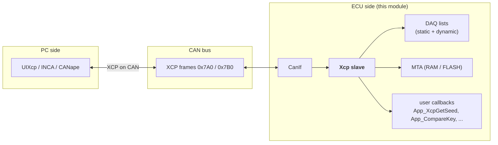
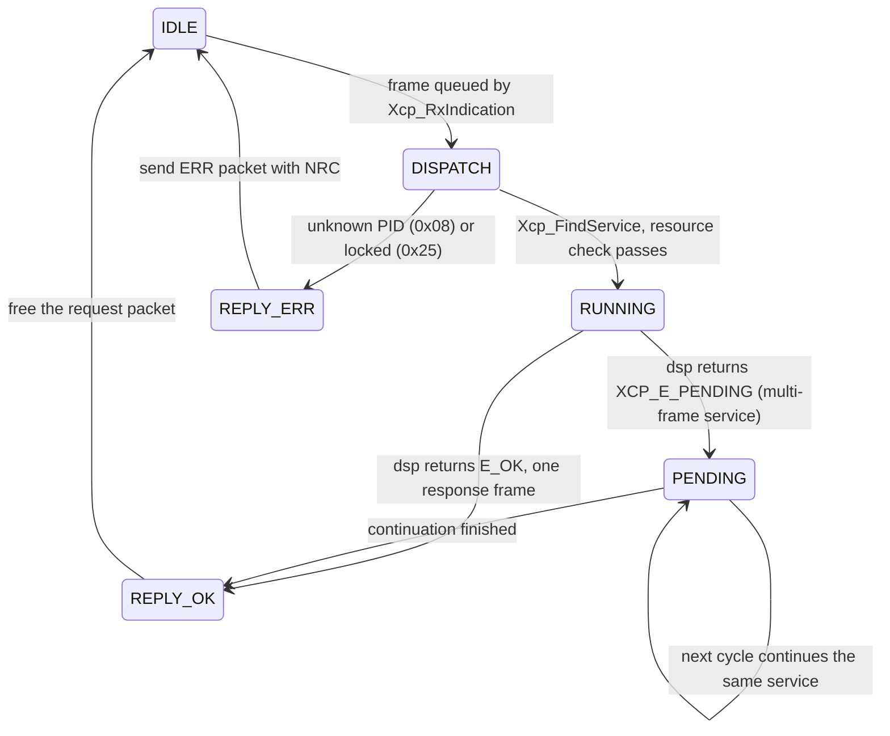
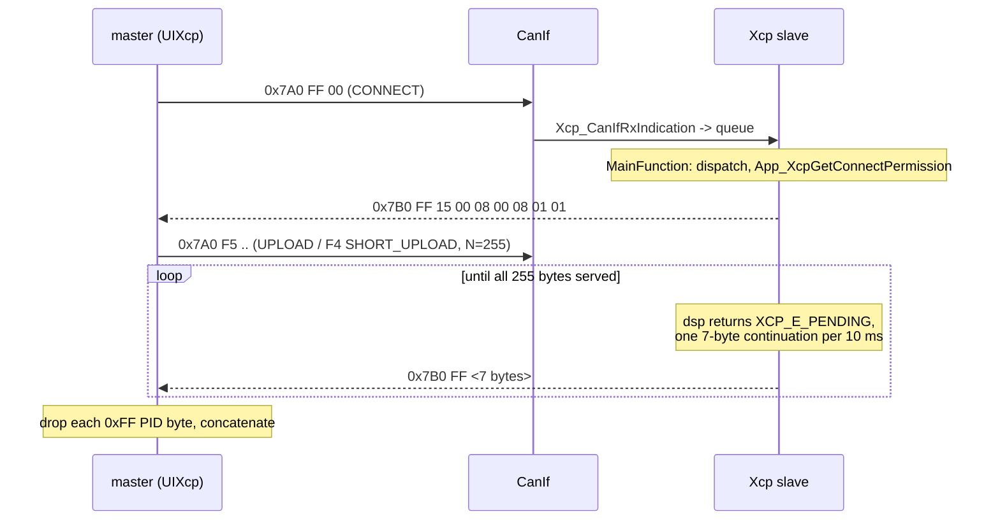

# Xcp - Universal Measurement and Calibration Protocol (slave)

> **In one sentence:** Xcp is the on-ECU XCP **slave** - the counterpart of the
> PC tool [`UIXcp`](UIXcp.md) (INCA, CANape, ...): it exposes an MTA (memory
> transfer address), calibration download, flash programming and event-driven
> DAQ measurement over CAN, governed by a seed-and-key resource lock.

| Item | Value |
| --- | --- |
| Module | `infras/communication/Xcp` (API: `infras/include/Xcp.h`) |
| Layer | Peer of the diagnostic stack: sits directly on [CanIf](CanIf.md) (fixed PDU ids), not routed through PduR |
| Configuration | `app/app/config/Xcp/Xcp.json` |
| Generator | `tools/generator/Xcp.py` -> `GEN/Xcp_Cfg.c` / `GEN/Xcp_Cfg.h` |
| Standard | ASAM XCP 1.5 / AUTOSAR CP R23-11 XCP (slave side) |
| Host counterpart | [`UIXcp`](UIXcp.md) PC tool |
| Demo | `scons --app=CanApp` + `CanSend` / `CanDump` (section 6) |

**Contents**

1. [What the module is for](#1-what-the-module-is-for)
2. [Where it sits in the stack](#2-where-it-sits-in-the-stack)
3. [Configuration](#3-configuration)
4. [How it works at runtime](#4-how-it-works-at-runtime)
5. [Public API](#5-public-api)
6. [Build and run a demo](#6-build-and-run-a-demo)
7. [Key notes and gotchas](#7-key-notes-and-gotchas)
8. [Troubleshooting](#8-troubleshooting)
9. [Known limitations and code review findings](#9-known-limitations-and-code-review-findings)
10. [Related documents](#10-related-documents)

---

## 1. What the module is for

* **Measurement (DAQ)** - periodic sampling of RAM/flash addresses, packed into
  DTOs and streamed on the bus without any request; driven by *event channels*
  (e.g. "every 100 ms").
* **Calibration (CAL/PAG)** - read (`Upload`/`ShortUpload`) and write
  (`Download`) arbitrary memory through the MTA pointer, typically ECU
  parameters.
* **Flash programming (PGM)** - `ProgramStart`/`ProgramClear`/`Program` hooks
  for a bootloader integration.
* **Protection** - every resource is locked until the master passes
  `GetSeed`/`Unlock`; `Connect` reports which resources the build supports.

The implementation follows the *ASAM XCP* protocol layer 2 semantics with a
command/response core, pending (multi-frame) services and a per-service
user-callback table generated from JSON.

---

## 2. Where it sits in the stack



Unlike the diagnostic services, XCP does **not** go through PduR/Dcm: CanIf
routes the two fixed PDUs straight into the module:

| PDU | Direction | Default CAN ID | `Up` |
| --- | --- | --- | --- |
| `CANIF_XCP_ON_CAN_RX` | master -> slave | `0x7A0` | `Xcp` |
| `CANIF_XCP_ON_CAN_TX` | slave -> master | `0x7B0` | `Xcp` |

The PDU names in the application's `CanIf.json` must be exactly
`XCP_ON_CAN_RX` / `XCP_ON_CAN_TX` - the generator hardcodes
`CANIF_XCP_ON_CAN_TX` as the transmit PDU id.

---

## 3. Configuration

`Xcp.json` ([app/app/config/Xcp/Xcp.json](../../app/app/config/Xcp/Xcp.json))
has three blocks that control three different parts of the slave:

| Block | Controls |
| --- | --- |
| `EventChannels` | the periodic DAQ event channels |
| `DaqList` | the preconfigured static DAQ lists and the dynamic DAQ pool sizes |
| `Services` | which XCP commands the slave accepts and which user API each one calls |

Plus two scalar keys: `PacketPoolSize` (default `8`, `#ifndef`-guarded macro
`XCP_PACKET_POOL_SIZE`) and `MainFunctionPeriod` (default `10` ms,
`XCP_MAIN_FUNCTION_PERIOD`). Note `UsePostBuildConfig` (default **true** here,
unlike most modules) only emits an `XCP_USE_PB_CONFIG` macro that `Xcp.c`
never reads - see section 9.

### 3.1 Event channels

```json
"EventChannels": [
  {"Name": "100ms", "TimeCycle": 100, "MaxDaqList": 8 },
  {"Name": "500ms", "TimeCycle": 500 },
  {"Name": "1s",    "TimeCycle": 1000 }
]
```

| Field | Required | Meaning |
| --- | --- | --- |
| `Name` | yes | channel label |
| `TimeCycle` | yes | period in ms, converted to `Xcp_MainFunction` cycles (round up) |
| `MaxDaqList` | optional | kept for spec completeness but **not consumed** (commented out in `Xcp_Priv.h`) |

### 3.2 DAQ lists

Two kinds coexist:

**Static** (`DaqList.StaticDaqList[]`) - built at compile time, all `const`:

| Field of an ODT entry | Meaning |
| --- | --- |
| `Address` | absolute address to sample |
| `Length` | size in bytes |
| `BitOffset` | optional, default `0xFF` (whole byte) |
| `Extension` | address space: `MEMORY` (default) or `FLASH` (`XCP_MTA_EXT_<name>`) |

Static DAQs occupy list indices `0 .. numOfStaticDaqList-1` and cannot be
re-allocated by `AllocDAQ`.

**Dynamic** (`DaqList.DynamicDaqList`) - a RAM pool the master carves at
runtime via `AllocDAQ` / `AllocODT` / `AllocODTEntry` / `SetDAQPtr` /
`WriteDAQ`:

| Field | Meaning |
| --- | --- |
| `DaqPoolSize` | number of extra DAQ lists beyond the static ones |
| `OdtPoolSize` | total ODTs available across all dynamic lists |
| `OdtEntryPoolSize` | total ODT entries across all dynamic ODTs |

### 3.3 Services

`Services[]` is the command table. Each entry becomes one `Xcp_ServiceType`
row; **the `Name` field is display-only** - the generator derives everything
from `Id` via its `ServiceMap`:

| Field | Required | Meaning |
| --- | --- | --- |
| `Name` | yes | display name only |
| `Id` | yes | the XCP PID (e.g. `"0xFF"` Connect) |
| `API` | optional | user callback name (section 3.4) |
| `Delay` | optional | `ProgramReset` only: ms before `Xcp_PerformReset()` |
| `maxBs`/`STmin`/`queSz` | optional | `ProgramStart` only, programming-mode parameters |

`preprocess()` rejects unknown PIDs (with the list of supported ones) and
duplicate PIDs, then **sorts the table by PID** - required by the binary search
in `Xcp_FindService()`. The resource bitmap that `Connect` reports is derived
automatically from which command groups are listed.

### 3.4 User callbacks

Services whose `API` is set call a user function via a per-service config
struct in `GEN/Xcp_Cfg.c`; the implementations live in
[app/app/src/xcp_user.c](../../app/app/src/xcp_user.c):

| Service | Callback signature |
| --- | --- |
| `Connect` | `App_XcpGetConnectPermission(mode, *nrc)` |
| `Disconnect` | `App_XcpDisconnecNotification(void)` |
| `GetSeed` | `App_XcpGetSeed(mode, resource, *seed, *seedLen, *nrc)` |
| `Unlock` | `App_CompareKey(*key, keyLen, *nrc)` |
| `ProgramStart` | `Xcp_GetProgramStartPermission(opStatus, *nrc)` |
| `ProgramReset` | `Xcp_GetProgramResetPermission(opStatus, *nrc)` |

The shipped `xcp_user.c` implements a toy seed/key (`seed ^ 0x78934673`) and
accepts program operations unconditionally - replace these before production.

### 3.5 Protected resources

| Resource | Bit | Gates |
| --- | --- | --- |
| `XCP_RES_CALPAG` | `0x01` | `Download`, `DownloadNext` (whole `CAL_`/`PAG_` groups) |
| `XCP_RES_DAQ` | `0x04` | all `DAQ_*` services |
| `XCP_RES_STIM` | `0x08` | STIM (unused) |
| `XCP_RES_PGM` | `0x10` | `Program*` services |

After `Xcp_Init` **all** resources are locked (`lockedResource = XCP_RES_MASK`);
`Unlock` clears the bits for the resources the key matched, `Disconnect` locks
everything again. A command whose resource is still locked gets NRC `0x25
Access locked`.

---

## 4. How it works at runtime

### 4.1 Command execution

Every received frame is queued into an STAILQ of pool packets; the main
function processes **one command per cycle**:



Response frames are queued into the same pool and drained by
`Xcp_MainFunction_Response()` via `CanIf_Transmit` - if the bus is busy the
frame simply stays queued for the next cycle.

A multi-frame service (e.g. `SHORT_UPLOAD` of 255 bytes with 7 payload bytes
per frame) keeps the request packet at the head of the queue and returns
`XCP_E_PENDING` until done - one response frame per main cycle:



### 4.2 DAQ

`Xcp_MainFunction_Daq()` runs from `Xcp_MainFunction`,
`Xcp_MainFunction_DaqWrite()` from `Xcp_MainFunction_Write` (both in the EcuM
main list). When an event channel timer expires, every started DAQ list
attached to it is sampled in ODT order and one DTO per ODT is queued for
transmission on `CANIF_XCP_ON_CAN_TX`. DAQ timestamps and `PID_OFF` are not
supported - every DTO starts with the ODT PID byte.

### 4.3 Scheduling

`Xcp_Init` is called by EcuM (`EcuM_DriverInitListOne`); `Xcp_MainFunction` and
`Xcp_MainFunction_Write` sit in the EcuM main list (`EcuM_Cfg.c`, guarded by
`USE_XCP`). Everything is single-threaded; the only ISR entry is
`Xcp_CanIfRxIndication`, which only copies the frame into the pool inside a
critical section - but note it also sends `Xcp_TxError` directly when the pool
is exhausted (section 9).

---

## 5. Public API

| Function | Purpose |
| --- | --- |
| `Xcp_Init(config)` | reset context, init packet pool, lock all resources |
| `Xcp_CanIfRxIndication(RxPduId, PduInfo)` | CanIf RX hook (validates `RxPduId == XCP_ON_CAN_CHL`) |
| `Xcp_CanIfTxConfirmation(TxPduId, result)` | no-op placeholder |
| `Xcp_RxIndication(channel, PduInfo)` | generic entry used by other transports |
| `Xcp_MainFunction` / `Xcp_MainFunction_Write` | request/response/event + DAQ processing |
| `Xcp_HasFreePacket` / `Xcp_AllocPacket` / `Xcp_FreePacket` | packet pool helpers |
| `Xcp_GetU32` / `Xcp_SetU32` / `Xcp_GetU16` / `Xcp_SetU16` | endian-safe accessors used by the DSP modules |
| `Xcp_GetVersionInfo(info)` | 4.0.0 |

Everything else (MTA, CAL, DAQ, PGM) is internal, split across
`Xcp_DspStd.c` (standard commands), `Xcp_DspCal.c` (CAL/PAG),
`Xcp_DspDaq.c` (DAQ), `Xcp_DspPgm.c` (PGM) and `Xcp_Mta.c` (memory access).

---

## 6. Build and run a demo

The host `CanApp` build already has XCP enabled, so the slave can be exercised
without hardware - `CanApp`, `CanSend` and `CanDump` all talk on the
`simulator_v2` virtual bus:

```bash
scons --app=CanApp      # the XCP slave  -> build\nt\GCC\CanApp\CanApp.exe
scons --app=CanSend     # request injector, installed to build\nt\GCC\one
scons --app=CanDump     # frame tracer,       installed to build\nt\GCC\one
```

Start the slave and the tracer in two shells:

```bash
build\nt\GCC\CanApp\CanApp.exe
build\nt\GCC\one\CanDump.exe -d simulator_v2 -p 0 -f 700#700
```

Then run any of these in a third shell - each line is one complete XCP command:

```bash
build\nt\GCC\one\CanSend.exe -d simulator_v2 -p 0 -i 7A0 -v FF00
build\nt\GCC\one\CanSend.exe -d simulator_v2 -p 0 -i 7A0 -v F440000000000000
build\nt\GCC\one\CanSend.exe -d simulator_v2 -p 0 -i 7A0 -v F4FF000000000000
```

`CanDump -f <Mask>#<Code>` keeps only frames where `(canid & Mask) == (Code &
Mask)`, i.e. just the XCP pair `0x7A0`/`0x7B0`.

| Request | `-v` payload | Answer on `0x7B0` |
| --- | --- | --- |
| `CONNECT` | `FF00` | `FF 15 00 08 00 08 01 01` |
| `SHORT_UPLOAD`, 64 bytes | `F440000000000000` | 1 request, 10 frames |
| `SHORT_UPLOAD`, 255 bytes | `F4FF000000000000` | 1 request, 37 frames |

The `CONNECT` answer is: `FF` positive, `15` = resource `CALPAG|DAQ|PGM`,
`00` COMM_MODE_BASIC, `08` MAX_CTO, `00 08` MAX_DTO, `01 01` protocol/transport
version. A `SHORT_UPLOAD` request is `F4 | Number | rsv | Ext | Addr32(LE)`;
`Ext 0` = `MTA_EXT_MEMORY`. The continuation frames come out one per
`XCP_MAIN_FUNCTION_PERIOD` (10 ms); the master strips the leading `0xFF` of
each frame and concatenates (see `UIMeasure::on_btnRead_clicked()` in
[UIXcp.cpp](../../tools/asone/src/ui/UIXcp.cpp)).

> On the host build `Xcp_MtaRead()` is stubbed (`linux`/`_WIN32`), so the
> uploaded bytes are stale buffer content - this recipe verifies sequencing,
> not data. Use a target build (e.g. the QEMU `VersatilepbCanApp`) for real
> data; addresses come from the map file or `tools/utils/readelf.py`.

---

## 7. Key notes and gotchas

* **XCP bypasses PduR and Dcm.** The two CanIf PDUs must be named
  `XCP_ON_CAN_RX` / `XCP_ON_CAN_TX`; nothing else needs configuring in PduR.
* **The service table is sorted by PID at generation time** and binary-searched
  at runtime - never hand-edit `GEN/Xcp_Cfg.c`.
* **`Services[].name` is decorative.** The PID decides everything; a PID not in
  the generator's `ServiceMap` fails the build with the list of supported PIDs.
* **One command per main cycle** (10 ms default). Bulk uploads continue at one
  frame per cycle - a 255-byte upload takes ~0.4 s. DAQ runs in the same
  main function.
* **All resources are locked after init.** Even `Download` needs
  `CONNECT -> GetSeed -> Unlock` first; NRC `0x25` means you forgot that.
* **The packet pool is shared** between RX commands and TX responses
  (`PacketPoolSize`, default 8). A busy DAQ plus a pending upload can exhaust
  it; the symptom is NRC `0x33 resource temporarily not accessible`.
* **8-byte frames only.** `XCP_PATCKET_MAX_SIZE = 8` (sic - typo included in
  the macro name) limits CTO/DTO to 7 payload bytes; the bus `LinkLayerDataLength` must be 8.
* **`UsePostBuildConfig` is a no-op** for this module (generated but never
  read by `Xcp.c`).
* **Single connection, single channel.** A second CONNECT from another
  "channel" gets NRC `0x10 CMD_BUSY`; on CAN there is only one channel anyway.

---

## 8. Troubleshooting

| Symptom | Likely cause |
| --- | --- |
| No response at all on `0x7B0` | `XCP_ON_CAN_TX` PDU missing/misnamed in `CanIf.json`, or the CAN TX main function is not scheduled (`USE_CAN` undefined - see below) |
| `0x25 Access locked` | run `GetSeed` + `Unlock` for the resource first |
| `0x33 Resource temporarily not accessible` | packet pool exhausted - raise `PacketPoolSize` (JSON or `-DXCP_PACKET_POOL_SIZE=N`) |
| `0x08 Command unknown` | the PID is not in `Services[]` of `Xcp.json` |
| `Abort pending service F4` in the log | `Xcp_TxResponse()` failed for a continuation frame - typically `Can_MainFunction_Write` not running because the platform build forgot `USE_CAN` |
| Response frames stop mid-upload | same as above; also check the TX queue is not starved by DAQ traffic |
| DAQ produces no data | DAQ list never started (`START_STOP_DAQ_LIST`), or the event channel `TimeCycle` is a multiple of `MainFunctionPeriod` that rounds to 0 cycles |
| Uploaded data is garbage on host build | expected - `Xcp_MtaRead` is stubbed on `linux`/`_WIN32`; verify on a target build |

---

## 9. Known limitations and code review findings

### 9.1 Functional limitations

* **CAN transport only.** `XCP_ON_FLEXRAY_CHL` / `XCP_ON_ETHERNET_CHL` are
  declared but not implemented; there is no XCP-on-Ethernet/TCP.
* **8-byte PDUs.** No CAN FD (`XCP_PATCKET_MAX_SIZE = 8`), no segmentation.
* **No DAQ timestamp / PID_OFF / STIM.** The mode bits are accepted but
  ignored; STIM (master -> slave DAQ) does not exist.
* **Single-connection.** The `activeChannel` concept exists, but CAN offers
  only channel 0.
* **Host MTA is stubbed** (`Xcp_Mta.c`), so measurement on `linux`/`_WIN32`
  returns stale data; flashing needs a per-target `Xcp_DspPgm.c` integration.

### 9.2 Code review findings

| # | Where | Finding |
| --- | --- | --- |
| 1 | `Xcp.c:345-366` | `Xcp_RxIndication` calls `Xcp_TxError(channel, nrc)` **directly** on errors - and `Xcp_RxIndication` runs in the CanIf RX context (potentially an ISR). `Xcp_TxError` allocates a pool packet (with `mp_alloc`, protected) and calls `CanIf_Transmit`, so error responses are sent from ISR context; on drivers that do not allow TX from ISR this is a latent race. |
| 2 | `Xcp.c:33-53` | `Xcp_FindService` computes `h = numOfServices - 1` and dereferences `config->services[0]` before any empty-table check; an `Xcp.json` without `Services[]` produces an underflow and an out-of-bounds read (same pattern as `LinIf_HeaderIndication`). |
| 3 | `Xcp.c:160-166` | When a *different* command arrives while a service is still `PENDING`, the code logs "Fatal memory error", aborts the pending service and starts the new one. For `Program*` sequences (which are legitimately pending for a long time) an interleaved command silently corrupts the programming session instead of answering `CMD_BUSY`. |
| 4 | `Xcp.c:210-231` | `Xcp_MainFunction_Response` has no timeout/queue-depth control: if `CanIf_Transmit` never succeeds (bus off), TX packets accumulate until the pool is exhausted, which then also blocks RX commands (`no free packet`). |
| 5 | `Xcp.c:419-421` | `Xcp_MainFunction_Write` runs DAQ *writing* from the EcuM main list while `Xcp_MainFunction_Daq` (sampling) runs in `Xcp_MainFunction` - both are the same list in `EcuM_Cfg.c:176`, so the split brings no parallelism, just a naming trap. |
| 6 | `Xcp_Priv.h:102-103` | `XCP_PATCKET_MAX_SIZE` - the macro name misspells "PACKET" and propagates into every DSP file; a rename is cosmetic but any grepping integrator will stumble. |
| 7 | `Xcp.py:340` | `UsePostBuildConfig` defaults to **true** (all other modules default to false) and the generated `XCP_USE_PB_CONFIG` macro is never referenced by `Xcp.c` (`Xcp_Init` ignores `ConfigPtr` unconditionally). Misleading dead configuration. |
| 8 | `Xcp.py:299-316` | `preprocess()` sorts `cfg["services"]` in place; the JSON itself is not rewritten, so the `GEN/Xcp_Cfg.c` order differs from the JSON order - surprising when diffing generated output. |
| 9 | `Xcp_DspDaq.c` (888 lines) | The DAQ implementation keeps per-DAQ state in plain RAM structures without checksum/protection; a master that misconfigures `WriteDAQ` entries can point ODT entries at arbitrary addresses, and sampling then reads those addresses every cycle - by design for a calibration tool, but worth noting in a security review alongside `App_CompareKey`. |
| 10 | `Xcp.c:124-207` | `resData[XCP_PATCKET_MAX_SIZE]` is a stack buffer of 8 bytes with `resMaxDataLen = 7`; any DSP function writing longer responses has no overflow detection beyond the `resMaxDataLen` convention - a new DSP command that ignores the convention overflows the stack silently. |

---

## 10. Related documents

* [UIXcp](UIXcp.md) - the PC-side XCP master tool (Qt), with its own doc
* [CanIf](CanIf.md) - the transport PDUs (`XCP_ON_CAN_RX` / `XCP_ON_CAN_TX`)
* [CanApp / virtual-can-env](virtual-can-env.md) - the virtual bus used by the
  demo
* Code: [Xcp.c](../../infras/communication/Xcp/Xcp.c),
  [Xcp_DspStd.c](../../infras/communication/Xcp/Xcp_DspStd.c),
  [Xcp_DspDaq.c](../../infras/communication/Xcp/Xcp_DspDaq.c),
  [Xcp_DspCal.c](../../infras/communication/Xcp/Xcp_DspCal.c),
  [Xcp_DspPgm.c](../../infras/communication/Xcp/Xcp_DspPgm.c),
  [Xcp_Mta.c](../../infras/communication/Xcp/Xcp_Mta.c),
  [Xcp.h](../../infras/include/Xcp.h),
  [Xcp.py](../../tools/generator/Xcp.py)
* ASAM XCP Part 1-5; AUTOSAR CP R23-11 Specification of XCP
