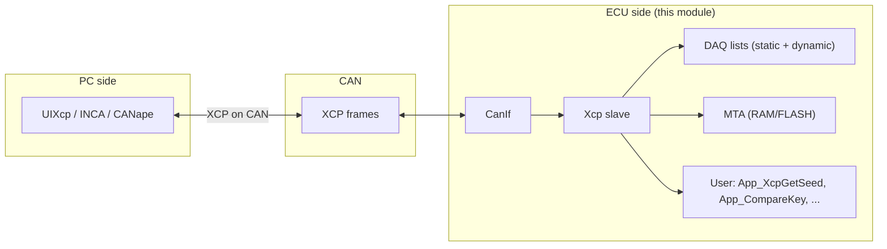

# Configuration Notes for the Xcp Module

The AUTOSAR [XCP](https://www.asam.net/standards/detail/xcp/) module is the on-ECU XCP **slave** — the counterpart of the PC tool [`UIXcp`](./UIXcp.md). It exposes a memory-transfer address (MTA), calibration download, programming flash and event-driven DAQ over a single transport (CAN for now, see section 6), and follows the *Specification of Module XCP AUTOSAR CP R23-11*.

Configuration is consumed by [Xcp.py](../../tools/generator/Xcp.py), which reads [`Xcp.json`](../../app/app/config/Xcp/Xcp.json) and emits `GEN/Xcp_Cfg.c` / `GEN/Xcp_Cfg.h` containing the service table, the DAQ layout and the configuration pointers. Every platform variant in `app/platform/<cpl>/<app>/config/Xcp/Xcp.json` is generated from the same JSON via the build system.



## 1. Configuration example

The shipped configuration lives at [app/app/config/Xcp/Xcp.json](../../app/app/config/Xcp/Xcp.json):

```json
{
  "class": "Xcp",
  "EventChannels": [
    {"name": "100ms", "TimeCycle": 100, "MaxDaqList": 8 },
    {"name": "500ms", "TimeCycle": 500 },
    {"name": "1s",    "TimeCycle": 1000 }
  ],
  "DaqList": {
    "StaticDaqList": [
      { "name": "Daq0", "ODTs": [
          { "name": "ODT0", "Entries": [
              { "Address": 0, "Length": 1 },
              { "Address": 10, "Length": 1 },
              { "Address": 20, "Length": 1 }
          ]},
          { "name": "ODT1", "Entries": [
              { "Address": 30, "Length": 1 },
              { "Address": 40, "Length": 1 },
              { "Address": 50, "Length": 1 }
          ]}
      ]}
    ],
    "DynamicDaqList": { "DaqPoolSize": 2, "OdtPoolSize": 16, "OdtEntryPoolSize": 128 }
  },
  "services": [
    { "name": "Connect",      "id": "0xFF", "API": "App_XcpGetConnectPermission" },
    { "name": "GetStatus",    "id": "0xFD" },
    { "name": "GetSeed",      "id": "0xF8", "API": "App_XcpGetSeed" },
    { "name": "Unlock",       "id": "0xF7", "API": "App_CompareKey" },
    { "name": "SetMTA",       "id": "0xF6" },
    { "name": "Upload",       "id": "0xF5" },
    { "name": "ShortUpload",  "id": "0xF4" },
    { "name": "Download",     "id": "0xF0" },
    { "name": "DownloadNext", "id": "0xEF" },
    { "name": "ProgramStart",   "id": "0xD2", "API": "Xcp_GetProgramStartPermission" },
    { "name": "ProgramClear",   "id": "0xD1" },
    { "name": "Program",        "id": "0xD0" },
    { "name": "ProgramNext",    "id": "0xCA" },
    { "name": "FreeDAQ",        "id": "0xD6" },
    { "name": "AllocDAQ",       "id": "0xD5" },
    { "name": "AllocODT",       "id": "0xD4" },
    { "name": "DAQ_ALLOC_ODT_ENTRY", "id": "0xD3" },
    { "name": "ClearDAQList",   "id": "0xE3" },
    { "name": "SetDAQPtr",      "id": "0xE2" },
    { "name": "WriteDAQ",       "id": "0xE1" },
    { "name": "ReadDAQ",        "id": "0xDB" },
    { "name": "SetDAQListMode", "id": "0xE0" },
    { "name": "StartStopDAQList", "id": "0xDE" },
    { "name": "StartStopSynch",   "id": "0xDD" },
    { "name": "GetDAQProcessorInfo", "id": "0xDA" },
    { "name": "GetDAQResolutionInfo","id": "0xD9" },
    { "name": "GetDAQListInfo",     "id": "0xD8" },
    { "name": "GetDAQEventInfo",    "id": "0xD7" },
    { "name": "ProgramReset",  "id": "0xCF", "delay": "100", "API": "Xcp_GetProgramResetPermission" },
    { "name": "Disconnect",    "id": "0xFE", "API": "App_XcpDisconnecNotification" }
  ]
}
```

The three blocks control three different parts of the slave:

| Block             | Controls                                                          |
| ----------------- | ----------------------------------------------------------------- |
| `EventChannels`   | The periodic DAQ event channels (`TimeCycle` in ms, see section 2) |
| `DaqList`         | The preconfigured DAQ lists and the dynamic DAQ pool sizes        |
| `services`        | The XCP commands the slave accepts and which user API each one calls |

## 2. Event channels

Each entry defines one **event channel** that fires its associated DAQ lists periodically. The JSON `TimeCycle` is in milliseconds; the generator converts it to `Xcp_MainFunction` cycles via `XCP_CONVERT_MS_TO_MAIN_CYCLES(TimeCycle)` (round up). The period of `Xcp_MainFunction` itself comes from the JSON key `MainFunctionPeriod` (default `10` ms), which the generator emits as `XCP_MAIN_FUNCTION_PERIOD`.

| Field        | Required | Meaning                                                                                  |
| ------------ | -------- | ---------------------------------------------------------------------------------------- |
| `name`       | yes      | Channel name, used as a label                                                            |
| `TimeCycle`  | yes      | Period in ms; converted to main-function cycles                                          |
| `MaxDaqList` | optional | Kept for spec completeness but **not consumed**: the field is commented out in `Xcp_Priv.h` and the generator never reads it |

Event channels are processed in `Xcp_MainFunction_Daq()`. When a channel's timer expires, every DAQ list attached to it is sampled in order and packed into one DTO per ODT, sent through `CanIf_Transmit` on `CANIF_XCP_ON_CAN_TX`.

## 3. DAQ lists

DAQ lists are how the slave publishes measurements to the master. Two kinds coexist:

### 3.1 Static DAQ lists (`DaqList.StaticDaqList[]`)

Pre-built at compile time from JSON — the ODTs and ODT entries are `const`, no runtime allocation:

```json
{ "name": "Daq0", "ODTs": [
    { "name": "ODT0", "Entries": [
        { "Address": 0, "Length": 1 },
        { "Address": 10, "Length": 1 }
    ]}
]}
```

| Field of an ODT entry | Meaning                                                                                  |
| --------------------- | ---------------------------------------------------------------------------------------- |
| `Address`             | Absolute address to sample (the master reads it back from `GetDAQEventInfo` etc.)         |
| `Length`              | Size in bytes                                                                            |
| `BitOffset`           | Optional, default `0xFF` (whole byte); otherwise bit-granular within the byte             |
| `Extension`           | Address space: `MEMORY` (default) or `FLASH`                                             |

The generator emits one `Xcp_OdtEntryType[]`, one `Xcp_OdtType[]` and one `Xcp_DaqListType` per DAQ list, all `const`. Static DAQs cannot be re-allocated by `AllocDAQ` — they always count from index `0` to `numOfStaticDaqList - 1`.

### 3.2 Dynamic DAQ lists (`DaqList.DynamicDaqList`)

A runtime pool the master can carve up with `AllocDAQ` / `AllocODT` / `AllocODTEntry` / `SetDAQPtr` / `WriteDAQ`. Sizes only:

| Field            | Meaning                                                |
| ---------------- | ------------------------------------------------------ |
| `DaqPoolSize`    | Number of extra DAQ lists beyond the static ones        |
| `OdtPoolSize`    | Total ODTs available across all dynamic DAQ lists       |
| `OdtEntryPoolSize` | Total ODT entries across all dynamic ODTs              |

The generator emits `Xcp_DynDaq0..N`, `Xcp_DynOdts[M]` and `Xcp_DynOdtEntries[K]` as plain (non-`const`) RAM; the slave carves them at runtime. Dynamic DAQs are freed en bloc by `ClearDAQList` on the affected list.

## 4. Services

`services[]` is the command table of the slave. Each entry becomes one `Xcp_ServiceType` row in `Xcp_Services[]`:

```c
{
  Xcp_Dsp<Name>,                 /* the implementation in Xcp_DspStd.c / Xcp_DspCal.c / ... */
  (const void *)&Xcp_<Name>Config,/* per-service config (NULL when no API) */
  XCP_PID_CMD_<GROUP>_<NAME>,    /* the XCP PID, e.g. XCP_PID_CMD_STD_CONNECT */
  /* resource */ XCP_RES_<...>,  /* the protected resource this command needs */
}
```

| Field        | Required | Meaning                                                                                       |
| ------------ | -------- | --------------------------------------------------------------------------------------------- |
| `name`       | yes      | Display name only — the generator never reads it; `Xcp_Dsp<Name>`, `XCP_PID_CMD_<GROUP>_<NAME>` and the resource bit are all derived from `id` through `ServiceMap` in Xcp.py |
| `id`         | yes      | The XCP PID, e.g. `"0xFF"` for `Connect`; can be decimal or hex                              |
| `API`        | optional | User callback for services that need one (see section 5)                                      |
| `delay`      | optional | For `ProgramReset` only: how many ms to wait after the command is accepted before `Xcp_PerformReset()` runs |
| `maxBs`/`STmin`/`queSz` | optional | For `ProgramStart` only, the programming-mode communication parameters              |

The PID prefix the generator uses (`STD_`, `CAL_`, `DAQ_`, `PGM_`) is the first four characters of the canonical name that [`ServiceMap`](../../tools/generator/Xcp.py#L87) holds for that PID — the `name` field of the JSON entry is not consulted (see also the PID list in [Xcp_Priv.h](../../infras/communication/Xcp/Xcp_Priv.h#L17)). A PID missing from `ServiceMap` fails the build.

### 4.1 The protected resources

Every service is gated by the resource(s) it touches. `Connect` reports the set the slave owns in `RESOURCE` (e.g. `0x15` = `CALPAG|DAQ|PGM`); the master has to `GetSeed` + `Unlock` that resource before any service gated on it is accepted. On `Disconnect` all resources are locked again.

| Resource        | Bit | Gates                                                                                |
| --------------- | --- | ------------------------------------------------------------------------------------ |
| `XCP_RES_CALPAG` | `0x01` | `Download`, `DownloadNext` — the generator maps the whole `CAL_` and `PAG_` groups here   |
| `XCP_RES_DAQ`    | `0x04` | All `DAQ_*` services                                                               |
| `XCP_RES_PGM`    | `0x10` | `ProgramStart`, `ProgramClear`, `Program`, `ProgramNext`, `ProgramReset`          |
| `XCP_RES_STIM`   | `0x08` | DAQ STIM (not used by this slave)                                                  |

A negative `0x25 = Access locked` is returned on `Xcp_MainFunction_Request()` whenever the current `lockedResource` still has the bit the service needs. The full resource list reported at `Connect` is `get_resource(cfg)` in the generator — derived from the `services[]` list, not declared by hand.

## 5. User callbacks

Every service whose `API` is set in the JSON calls a user function via a per-service config struct in `Xcp_Cfg.c`. The integration point for the application is [app/app/src/xcp_user.c](../../app/app/src/xcp_user.c), which is where the callbacks are implemented for every platform variant.

| Service        | `API` callback signature                                                                                                  | Called by                       |
| -------------- | ------------------------------------------------------------------------------------------------------------------------- | ------------------------------- |
| `Connect`      | `Std_ReturnType App_XcpGetConnectPermission(uint8_t mode, Xcp_NegativeResponseCodeType *nrc)`                            | `Xcp_DspConnect`                |
| `Disconnect`   | `Std_ReturnType App_XcpDisconnecNotification(void)`                                                                       | `Xcp_DspDisconnect`             |
| `GetSeed`      | `Std_ReturnType App_XcpGetSeed(uint8_t mode, uint8_t resource, uint8_t *seed, uint16_t *seedLen, Xcp_NegativeResponseCodeType *nrc)` | `Xcp_DspGetSeed`                |
| `Unlock`       | `Std_ReturnType App_CompareKey(uint8_t *key, uint16_t keyLen, Xcp_NegativeResponseCodeType *nrc)`                        | `Xcp_DspUnlock`                 |
| `ProgramStart` | `Std_ReturnType Xcp_GetProgramStartPermission(Xcp_OpStatusType opStatus, Xcp_NegativeResponseCodeType *nrc)`              | `Xcp_DspProgramStart`           |
| `ProgramReset` | `Std_ReturnType Xcp_GetProgramResetPermission(Xcp_OpStatusType opStatus, Xcp_NegativeResponseCodeType *nrc)`             | `Xcp_DspProgramReset` (after `delay` ms) |

Anything not listed has no callback and `Xcp_Priv.h` declares no user API for it — the implementation either needs nothing (`GetStatus`, `SetMTA`, `Upload`, `ShortUpload`, `Download`, the DAQ list/info commands) or it calls the upper layer directly (`Program`, `ProgramNext`, `ProgramClear` — see [Xcp_DspPgm.c](../../infras/communication/Xcp/Xcp_DspPgm.c)).

The shipped `xcp_user.c` implements a minimal seed-and-key scheme (`lXcpSeed ^ 0x78934673`) and accepts `ProgramReset` / `ProgramStart` unconditionally. Adapt the four key callbacks (`GetConnectPermission`, `GetSeed`, `CompareKey`, `DisconnecNotification`) and the two program callbacks to your security policy.

## 6. Transport

This slave currently speaks **XCP on CAN only**. The receive side is hooked through `Xcp_CanIfRxIndication()`, which validates `RxPduId == XCP_ON_CAN_CHL` (`0`) and drops every command other than `0xFF CONNECT` until a connection is established. The transmit side goes through `CanIf_Transmit(CANIF_XCP_ON_CAN_TX, &PduInfo)`. The pool of `XCP_PACKET_POOL_SIZE` (JSON `PacketPoolSize`, default `8`) slots in [Xcp.c](../../infras/communication/Xcp/Xcp.c#L28) holds the received commands and doubles as the TX fallback when the bus is busy — see `Xcp_TxResponse()` and `Xcp_TxError()` in [Xcp.c](../../infras/communication/Xcp/Xcp.c#L61).

The transport-layer PDU IDs come from the application's `CanIf.json` configuration:

| PDU ID                  | Direction | Default CAN ID |
| ---------------------- | --------- | ------------- |
| `CANIF_XCP_ON_CAN_RX`  | master → slave | `0x7A0`   |
| `CANIF_XCP_ON_CAN_TX`  | slave → master | `0x7B0`   |

The slave's `XCP_PATCKET_MAX_SIZE` is fixed at `8` bytes, so `LL_DL` of the bus must be `8` (the default `target.LL_DL` in the PC tool's [`xcp.json`](../../tools/asone/examples/xcp.json)). `FlexRay` and `Ethernet` channel IDs are declared in [`Xcp.h`](../../infras/include/Xcp.h#L13) but not implemented.

## 7. Generator

[Xcp.py](../../tools/generator/Xcp.py) reads `Xcp.json` and emits `GEN/Xcp_Cfg.h` plus `GEN/Xcp_Cfg.c`:

1. `preprocess()` converts each `id` to a number, rejects PIDs that are not in `ServiceMap` or that appear twice, and sorts the services by PID, so the runtime can binary-search the table in `Xcp_FindService()`.
2. The header defines `XCP_PACKET_POOL_SIZE` (JSON `PacketPoolSize`, default `8`), `XCP_MAIN_FUNCTION_PERIOD` (JSON `MainFunctionPeriod`, default `10` ms) and one `XCP_USE_SERVICE_<GROUP>_<NAME>` macro per service — the source files use these macros to compile only the implementations that are actually configured. Both macros are `#ifndef`-guarded, so a build define still overrides them.
3. The C file declares every `API` callback as `extern`, instantiates the per-service config struct (`Xcp_<Name>Config`), the static DAQ ODTs, the dynamic DAQ pool, the `Xcp_Services[]` table and finally the `Xcp_Config` root that `Xcp_GetConfig()` returns.
4. `get_resource(cfg)` walks `services[]`, derives the union of the resource groups touched by the listed commands, and writes that into `Xcp_Config.resource` — this is the bitmap `Connect` reports to the master.

The build regenerates both files whenever `Xcp.json` changes; the only thing that is hand-written is `xcp_user.c` (the user callbacks) and the slave sources under [infras/communication/Xcp](../../infras/communication/Xcp/).

## 8. Limitations

- Transport is **CAN** at this moment. `XCP_ON_FLEXRAY_CHL` and `XCP_ON_ETHERNET_CHL` are reserved IDs but the slave only registers `Xcp_CanIfRxIndication`.
- Maximum PDU size is `XCP_PATCKET_MAX_SIZE = 8`, so `LL_DL` of the bus must be `8`. There is no oversize-segmentation support.
- DAQ timestamp and `PID_OFF` are not supported; `DAQ_LIST_MODE_TIMESTAMP` / `DAQ_LIST_MODE_PID_OFF` bits are ignored.
- `STIM` (master → slave DAQ) is not implemented. The slave accepts only DAQ direction.
- `MTA_EXT_MEMORY` and `MTA_EXT_FLASH` are accepted by `Xcp_MtaRead/Write` on real targets; on `linux` / `_WIN32` host builds the read/write bodies are stubbed (`#if defined(linux) || defined(_WIN32)`), see [Xcp_Mta.c](../../infras/communication/Xcp/Xcp_Mta.c). Flashing a real target still requires a custom `Program*` integration in [Xcp_DspPgm.c](../../infras/communication/Xcp/Xcp_DspPgm.c).
- The slave is single-channel and single-connection. The `0x10 ERR_CMD_BUSY` branch in `Xcp_RxIndication()` fires only when a command arrives on a channel other than the active one; on CAN the channel is always `XCP_ON_CAN_CHL`, so that branch is unreachable today and reserved for further transports.
- More than `XCP_PACKET_POOL_SIZE` frames in flight gets `0x33 ERR_RESOURCE_TEMPORARY_NOT_ACCESSIBLE`; if it shows up under load, raise the pool with the `PacketPoolSize` attribute of `Xcp.json` (or a `-DXCP_PACKET_POOL_SIZE=N` build define) rather than editing the generated `Xcp_Cfg.h`.

## 9. Verifying the slave with CanSend

The host `CanApp` build already has XCP enabled (`app/app/SConscript` registers `config/Xcp/Xcp.json`), so the slave can be exercised without any hardware: `CanApp` talks on the `simulator_v2` virtual bus (a UDP multicast group) and the PC tools `CanSend` / `CanDump` join that same bus on the same machine.

Build the three pieces:

```bash
scons --app=CanApp      # the XCP slave  -> build\nt\GCC\CanApp\CanApp.exe
scons --app=CanSend     # request injector, installed to build\nt\GCC\one
scons --app=CanDump     # frame tracer,       installed to build\nt\GCC\one
```

Start the slave and the tracer in two shells:

```bash
build\nt\GCC\CanApp\CanApp.exe
build\nt\GCC\one\CanDump.exe -d simulator_v2 -p 0 -f 700#700
```

Then run any of these in a third shell — each line is a complete command, copy it as is and press Enter:

```bash
build\nt\GCC\one\CanSend.exe -d simulator_v2 -p 0 -i 7A0 -v FF00
build\nt\GCC\one\CanSend.exe -d simulator_v2 -p 0 -i 7A0 -v F440000000000000
build\nt\GCC\one\CanSend.exe -d simulator_v2 -p 0 -i 7A0 -v F4FF000000000000
```

`CanDump -f <Mask>#<Code>` keeps only the frames where `(canid & Mask) == (Code & Mask)`, so `-f 700#700` restricts the trace to the XCP IDs `0x7A0` (request) and `0x7B0` (response) and hides the unrelated traffic on the shared bus; drop the option to watch everything.

`CanSend` sends the raw CTO payload as hex (`-i` CAN ID, `-v` data). `CanDump` prints the whole data array, so the trailing `55` bytes are display fill and not part of the request. The three commands above are in the same order as the table rows:

| Request | `-v` payload | Answer on `0x7B0` |
| ------- | ------------ | ----------------- |
| `CONNECT` | `FF00` | `FF 15 00 08 00 08 01 01` |
| `SHORT_UPLOAD`, 64 bytes | `F440000000000000` | 1 request, 10 frames, 64 bytes |
| `SHORT_UPLOAD`, 255 bytes | `F4FF000000000000` | 1 request, 37 frames, 255 bytes |

The `CONNECT` answer is `FF` (positive response), `15` (`resource` = `CALPAG|DAQ|PGM`), `00` (`COMM_MODE_BASIC`), `08` (`MAX_CTO`), `00 08` (`MAX_DTO`) and `01 01` (protocol/transport layer version).

A `SHORT_UPLOAD` request is always 8 bytes: `F4 | Number | reserved | Extension | Address (32-bit, little endian)`. `Number` is the byte count to read and `Extension` `0` selects `MTA_EXT_MEMORY`.

One request may ask for up to 255 bytes, but a single CTO frame only carries `XCP_PATCKET_MAX_SIZE - 1` = 7 payload bytes. `Xcp_DspShortUpload()` therefore returns `XCP_E_PENDING` while bytes are left, and `Xcp_MainFunction_Request()` emits one response frame per invocation, keeping the request packet at the head of `rxPackets` until it is finished. As `Xcp_MainFunction()` is driven by `MainTask_10ms()` → `EcuM_BswService()` → `EcuM_DriverMainList[]`, the continuation frames come out one per 10 ms (`XCP_MAIN_FUNCTION_PERIOD`):

```text
2026-10-16 21:49:57 7A0 dlc=08 data=[F4,40,00,00,00,00,00,00]  <- 1 request for 64 bytes
2026-10-16 21:49:57 7B0 dlc=08 data=[FF,80,3F,FE,E2,F6,7F,00]  <- frame 1 of 10
2026-10-16 21:49:57 7B0 dlc=08 data=[FF,80,3F,FE,E2,F6,7F,00]  <- +10 ms
...
2026-10-16 21:49:57 7B0 dlc=02 data=[FF,80]                    <- frame 10, last byte
```

Every response frame starts with `XCP_PID_RES` (`0xFF`); the master drops that first byte of each frame and concatenates the rest, see `UIMeasure::on_btnRead_clicked()` in [UIXcp.cpp](../../tools/asone/src/ui/UIXcp.cpp#L362). `CanSend` only injects the request, so pair it with `CanDump` to watch both directions.

> Two caveats when using the host build:
>
> - `Xcp_MtaRead()` is stubbed on `linux` / `_WIN32` (see section 8), so the payload bytes are stale buffer content and not the memory at `Address`. The recipe above verifies the request/response sequencing, not the data. To check real data, run it against a target build (e.g. the QEMU `VersatilepbCanApp`) and take the address from the map file or from the JSON exported by `tools/utils/readelf.py`.
> - A log line `Abort pending service F4` (from [Xcp.c](../../infras/communication/Xcp/Xcp.c#L177)) means that `Xcp_TxResponse()` failed for a continuation frame. The usual cause is that the CAN driver's TX main function is never scheduled: `Can_MainFunction_Write` sits in `EcuM_DriverMainFastList` behind `#ifdef USE_CAN`, so a platform that fails to define `USE_CAN` stops after the very first frame.